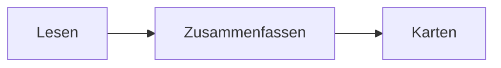
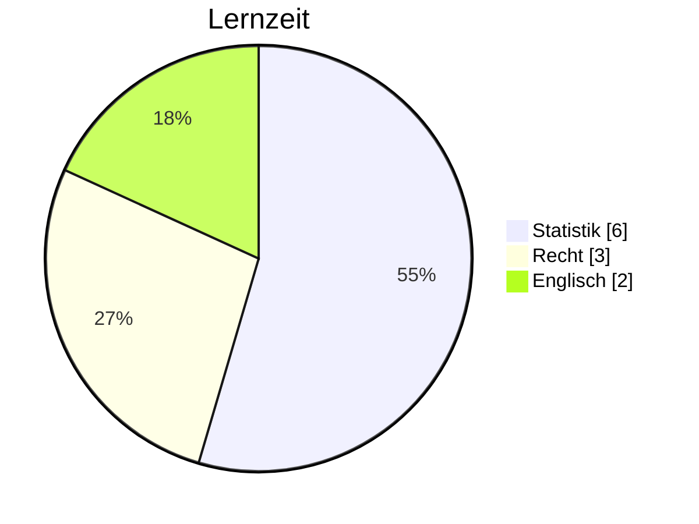

# Markdown

Alles, was Schrumbi zeichnen kann. Jedes Beispiel zeigt das Ergebnis, ein Klick auf {ui:Markdown} zeigt den Text dahinter.

## Text

````example Hervorheben
**fett**, *kursiv*, ~~durchgestrichen~~, `Code` und ==markiert==.
````

````example Farbig markieren
==🔴wichtig==, ==🟠offen==, ==🟡prüfen==, ==🟢fertig==, ==🔵Idee==, ==🟣Frage==
````

````example Zeilenumbruch
Eine Zeile
direkt darunter.

Eine Leerzeile beginnt einen neuen Absatz.
````

## Überschriften

````example Sechs Stufen
# Stufe 1
## Stufe 2
### Stufe 3
#### Stufe 4
##### Stufe 5
###### Stufe 6
````

## Listen

````example Aufzählung und Nummern
- Punkt
  - eingerückt
- noch ein Punkt

1. Erstens
2. Zweitens
````

````example Aufgaben
- [ ] offen
- [x] erledigt
- [?] Frage
- [/] angefangen
````

## Links

````example Zwischen Notizen
[[Beispiel]], [[Beispiel|mit anderem Text]], [[Beispiel#Zweiter Teil]] und [[Noch nicht angelegt]].
````

````example Ins Netz
[Schrumbi](https://example.org), direkt: https://example.org oder www.example.org
````

Im Beispiel sind Links still. In deinen Notizen öffnet ein Klick das Ziel, ein Link auf eine fehlende Notiz legt sie an.

## Einbetten

````example Notiz oder Abschnitt
![[Beispiel#Zweiter Teil]]
````

````example Bild mit Breite
![[Diagramm.svg|160]]
````

`|160x90` setzt Breite und Höhe. Auch PDFs gehen: `![[Skript.pdf#page=3]]` zeigt Seite 3. Ton bekommt einen Player, ein Video eine Karte, die es im Player öffnet.

## Callouts

````example Hinweis
> [!note] Merken
> Schrumbi und Obsidian zeichnen das gleich.
````

````example Eingeklappt
> [!tip]- Lösung zeigen
> Erst selbst versuchen.
````

````example Verschachtelt
> [!warning] Achtung
> > [!info] Innen
> > Callouts dürfen ineinander stehen.
````

| Typ | Andere Namen |
|---|---|
| `abstract` | `summary`, `tldr` |
| `tip` | `hint`, `important` |
| `success` | `check`, `done` |
| `question` | `help`, `faq` |
| `warning` | `caution`, `attention` |
| `failure` | `fail`, `missing` |
| `danger` | `error` |
| `quote` | `cite` |

Dazu kommen `note`, `info`, `todo`, `bug` und `example`. Unbekannte Typen sehen aus wie `note`. `-` nach dem Typ klappt ein, `+` klappt auf und lässt sich zuklappen.

## Tabellen

````example Ausrichten
| Links | Mitte | Rechts |
|:--|:-:|--:|
| a | b | 1,0 |
| ccc | ddd | 22,5 |
````

## Zitat und Trennlinie

````example Zitat
> Was man lernen muss, um es zu tun, lernt man, indem man es tut.

---

Unter der Linie geht es weiter.
````

## Code

````example Mit Farben
```rust
fn main() {
    println!("Hallo");
}
```
````

## Formeln

- {ui:Formelblock} im Kontextmenü oder {ui:Formelblock einfügen} in der {key:CommandPalette} legt die `$$`-Zeilen an.
- In einer Formel schlägt `\` Befehle vor, etwa `\frac` oder `\sum`.
- Steht das schließende `$$` schon da, springt das Tippen von `$$` darüber hinweg.
- Kennt Schrumbi einen Befehl nicht, bleibt die Formel als Text in Orange stehen und nennt den Befehl.
- `\tag{1}` setzt eine Nummer hinter die Formel.

````example Im Text und abgesetzt
Inline $a^2 + b^2 = c^2$, abgesetzt:

$$
\sum_{i=1}^{n} i = \frac{n(n+1)}{2}
$$
````

````example Chemie
$\ce{2H2 + O2 -> 2H2O}$
````

## Diagramme

````example Ablauf

````

````example Kreis

````

## Fußnoten und Tags

````example Fußnoten
Ein Satz mit Quelle[^1] und einer kurzen Anmerkung^[direkt im Text].

[^1]: Die Quelle.
````

````example Tags
#prüfung #statistik/kapitel-2
````

## Verborgen

````example Kommentare
Sichtbar %%nur im Quelltext%% sichtbar. <!-- auch das bleibt verborgen -->
````

## HTML

````example Was geht
<u>unterstrichen</u>, <small>klein</small>, <kbd>⌘K</kbd>, H<sub>2</sub>O, x<sup>2</sup>, <span style="color:red">rot</span>
````

````example Ausklappen
<details>
<summary>Mehr zeigen</summary>
Der Inhalt erscheint nach einem Klick.
</details>
````

## Eigenschaften

````example Am Anfang der Datei
---
status: offen
termin: 2026-11-20
tags: [prüfung]
---
Eigenschaften stehen ganz oben zwischen zwei `---`.
````

## Abfragen

````example Notizen sammeln
```query
tag:prüfung
```
````

Die Abfrage sucht in deinen Notizen, mit denselben Suchbefehlen wie {key:searchFiles}. Auch im Beispiel kommen die Treffer aus deinem Ordner.

Blöcke von Obsidian-Plugins wie `dataview` zeigt Schrumbi als Quelltext mit Hinweis.

## Block-ID

````example Absatz verlinken
Dieser Absatz bekommt eine Adresse. ^merksatz
````

Mit `[[Notiz#^merksatz]]` verlinkst du genau diesen Absatz, mit `![[Notiz#^merksatz]]` bettest du ihn ein.
