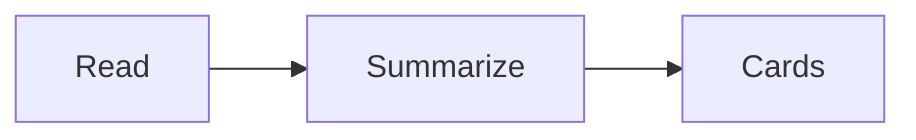
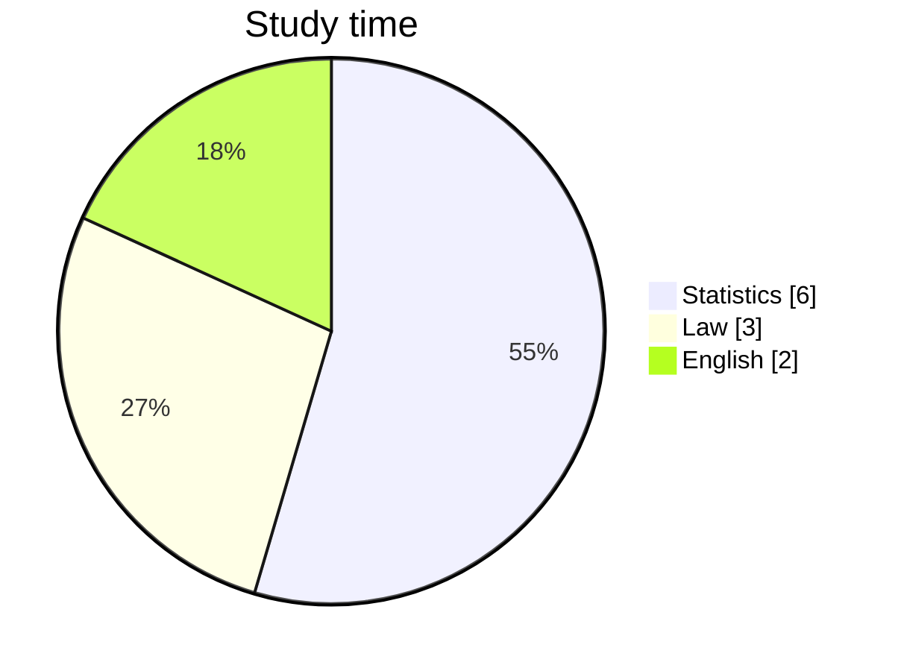

# Markdown

Everything Schrumbi can draw. Each example shows the result, a click on {ui:Markdown} shows the text behind it.

## Text

````example Emphasis
**bold**, *italic*, ~~strikethrough~~, `code` and ==highlighted==.
````

````example Colored highlights
==🔴important==, ==🟠open==, ==🟡check==, ==🟢done==, ==🔵idea==, ==🟣question==
````

````example Line break
One line
right below.

A blank line starts a new paragraph.
````

## Headings

````example Six levels
# Level 1
## Level 2
### Level 3
#### Level 4
##### Level 5
###### Level 6
````

## Lists

````example Bullets and numbers
- Item
  - indented
- another item

1. First
2. Second
````

````example Tasks
- [ ] open
- [x] done
- [?] question
- [/] started
````

## Links

````example Between notes
[[Example]], [[Example|with other text]], [[Example#Second part]] and [[Not created yet]].
````

````example To the web
[Schrumbi](https://example.org), directly: https://example.org or www.example.org
````

In the example, links are inert. In your notes, a click opens the target, a link to a missing note creates it.

## Embedding

````example Note or section
![[Example#Second part]]
````

````example Image with width
![[Chart.svg|160]]
````

`|160x90` sets width and height. PDFs work too: `![[Script.pdf#page=3]]` shows page 3. Audio gets a player, a video gets a card that opens it in the player.

## Callouts

````example Note
> [!note] Remember
> Schrumbi and Obsidian draw this the same way.
````

````example Collapsed
> [!tip]- Show solution
> Try it yourself first.
````

````example Nested
> [!warning] Careful
> > [!info] Inside
> > Callouts may be nested.
````

| Type | Other names |
|---|---|
| `abstract` | `summary`, `tldr` |
| `tip` | `hint`, `important` |
| `success` | `check`, `done` |
| `question` | `help`, `faq` |
| `warning` | `caution`, `attention` |
| `failure` | `fail`, `missing` |
| `danger` | `error` |
| `quote` | `cite` |

Also there are `note`, `info`, `todo`, `bug` and `example`. Unknown types look like `note`. `-` after the type collapses it, `+` expands it and lets it be collapsed.

## Tables

````example Alignment
| Left | Center | Right |
|:--|:-:|--:|
| a | b | 1.0 |
| ccc | ddd | 22.5 |
````

## Quote and Divider

````example Quote
> What we have to learn to do, we learn by doing.

---

Below the line it continues.
````

## Code

````example With colors
```rust
fn main() {
    println!("Hello");
}
```
````

## Formulas

- {ui:Formelblock} in the context menu or {ui:Formelblock einfügen} in the {key:CommandPalette} adds the `$$` lines.
- Inside a formula, `\` suggests commands such as `\frac` or `\sum`.
- When the closing `$$` is already there, typing `$$` steps over it.
- If Schrumbi does not know a command, the formula stays as text in orange and names the command.
- `\tag{1}` puts a number behind the formula.

````example Inline and display
Inline $a^2 + b^2 = c^2$, display:

$$
\sum_{i=1}^{n} i = \frac{n(n+1)}{2}
$$
````

````example Chemistry
$\ce{2H2 + O2 -> 2H2O}$
````

## Diagrams

````example Flow

````

````example Pie

````

## Footnotes and Tags

````example Footnotes
A sentence with a source[^1] and a short remark^[right in the text].

[^1]: The source.
````

````example Tags
#exam #statistics/chapter-2
````

## Hidden

````example Comments
Visible %%only in the source%% visible. <!-- this stays hidden too -->
````

## HTML

````example What works
<u>underlined</u>, <small>small</small>, <kbd>⌘K</kbd>, H<sub>2</sub>O, x<sup>2</sup>, <span style="color:red">red</span>
````

````example Collapsible
<details>
<summary>Show more</summary>
The content appears after a click.
</details>
````

## Properties

````example At the start of the file
---
status: open
due: 2026-11-20
tags: [exam]
---
Properties sit at the very top between two `---`.
````

## Queries

````example Collect notes
```query
tag:exam
```
````

The query searches your notes, with the same search operators as {key:searchFiles}. In the example too, the hits come from your folder.

Blocks from Obsidian plugins like `dataview` are shown by Schrumbi as source with a notice.

## Block ID

````example Link a paragraph
This paragraph gets an address. ^keypoint
````

With `[[Note#^keypoint]]` you link exactly this paragraph, with `![[Note#^keypoint]]` you embed it.
