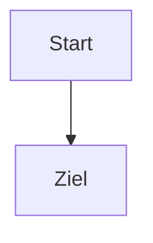

# Syntax

Fett **fett**, kursiv *kursiv*, Code `code`, ~~durch~~, ==markiert==, ==🔴rot==, ==🟢grün==.
Zeile eins
Zeile zwei nach einfachem Umbruch.

## Links

[[Ziel]] und [[Ziel|Alias]] und [[Ziel#Zweite Stufe]] und [[Ziel#^block1]] und [[#Links]] und [[Fehlt noch]].
[Markdown](Ziel.md) und [Mit Leerzeichen](Ordner/Tief/Tiefe%20Notiz.md) und [Extern](https://example.org).
| Spalte | Link |
|--|--|
| a | [[Ziel\|in Tabelle]] |

## Einbettungen

![[Ziel#Zweite Stufe]]

![[Ziel#^block1]]

![[bild.png|120]]

![[diagramm.svg]]

![[doc.pdf#page=1]]

![[ton.wav]]

![[film.mp4]]

![[Karte.canvas]]

![[Tabelle.base]]

![[Syntax]]

## Callouts

> [!note] Hinweis
> Text im Callout mit [[Ziel]].

> [!warning]- Eingeklappt
> Unsichtbar bis zum Klick.

> [!tip]+ Aufgeklappt
> > [!bug] Verschachtelt
> > Innen.

> [!unbekannt] Fällt auf Notiz zurück

## Kommentare

Sichtbar %%unsichtbar%% wieder sichtbar.

%%
Block unsichtbar
%%

## Aufgaben

- [ ] offen
- [x] fertig
- [?] Frage
- [/] halb

## Fußnoten

Text[^1] und inline^[Inline-Fußnote].

[^1]: Die Fußnote.

## Tags

#projekt #projekt/teil #Äpfel #123 keine Zahl, `#code` kein Tag.

## Mathe

Inline $x^2 + y_1$ und Block:

$$
\frac{a}{b} = \sum_{i=1}^{n} i^2
$$

## Mermaid



## Abfrage

```query
tag:projekt
```

```base
views:
  - type: table
    name: Alle
```

## HTML

<kbd>⌘K</kbd> und <!-- verborgen --> sichtbar.

Absatz mit Block-ID. ^absatz
